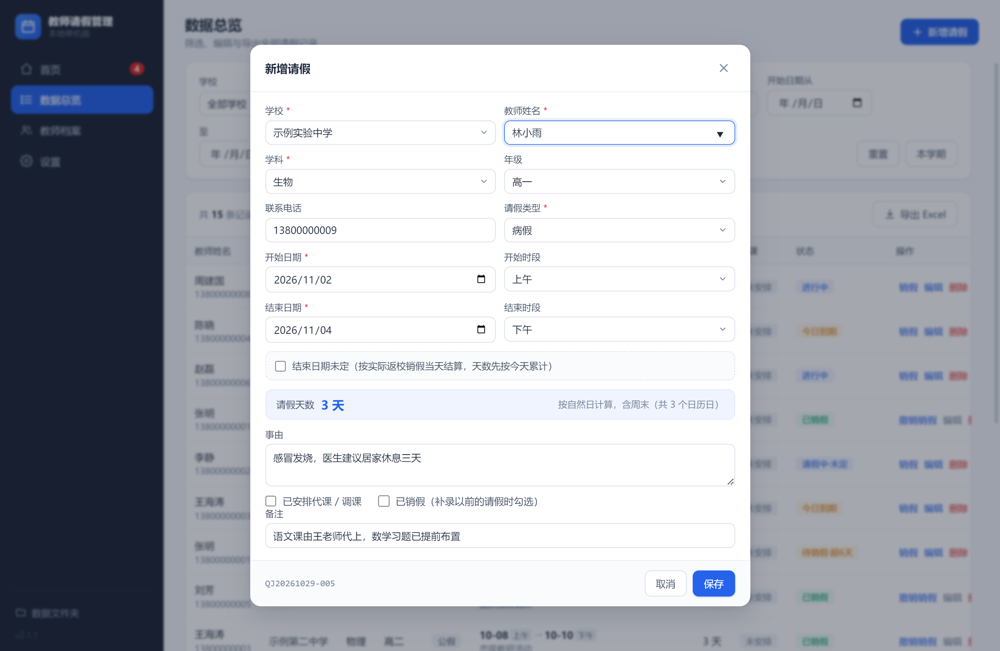
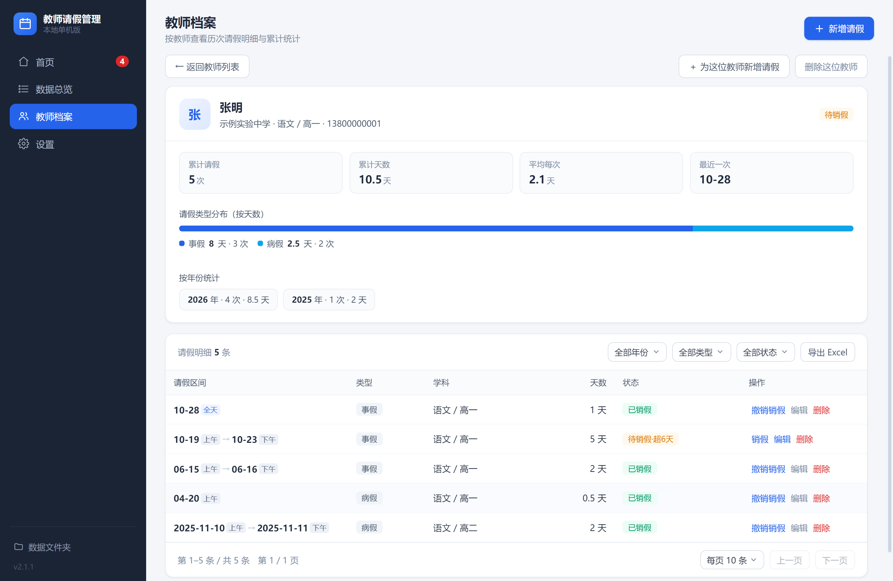

# 教师请假管理系统

一款为学校教务场景做的**教师请假台账**桌面软件。免安装、绿色版，双击 `exe` 就能用，
数据全部保存在程序所在文件夹里，不联网、不上传、不写注册表。

> 面向的真实场景：教务处每天要回答三个问题 ——「谁现在在请假？」「谁的假到期了还没销假？」
> 「这个月请了多少天？」本软件把这三件事做到打开首页就能看见。


<p align="center">
  
  
  
  
</p>

---

## 界面预览

| 首页 · 未销假提醒 | 首页 · 今日在假 |
|---|---|
|  |  |

| 数据总览 | 新增请假 |
|---|---|
|  |  |

| 教师档案 | 教师详情 |
|---|---|
|  |  |

| 设置 | 数据与备份 |
|---|---|
|  |  |

> 截图使用虚构的演示数据（示例学校、示例教师），不含任何真实记录。

---

## 功能

**请假记录**

- 学校 / 姓名 / 学科 / 年级 / 电话 / 请假类型 / 事由，一表录入
- **支持半天粒度**：开始与结束都可精确到上午或下午，`10-28 上午 → 下午` 计 1 天，
  同一天拆成「上午一条 + 下午一条」也不会被误判为时间冲突
- 结束日期可勾「未定」（长期病假、待定归期），天数按「开始 → 今天」实时累计
- 录入时实时算天数，保存前显示计算依据
- 同一教师（姓名 + 学校为唯一键）的请假**时段重叠会被硬拦截**，跨学校同名不误伤

**首页提醒**

- 三档到期提醒：`已超期`（红）/ `今天刚结束·今日到期`（黄）/ `还没结束，暂时不用销假`（蓝）
- 未定结束的记录按「已请 N 天」单独预警，阈值可配
- 今日在假一览，按学校 / 学科分组，卡片上直接销假（带二次确认，防止连点误销下一条）
- 侧栏红点只统计「现在就该处理」的条数，不打扰

**数据与统计**

- 数据总览：按学校 / 姓名 / 学科 / 类型 / 状态 / 日期区间 / 代课组合筛选，多列排序，分页
- 教师档案：按姓名 + 学校聚合，单人详情页含累计统计、类型分布、按年统计与明细
- 学期视图与「本学期」快捷筛选
- Excel 导出：整表导出或单人明细导出（含教师汇总页、类型与年份占比）
- 备份与恢复：每次保存前自动备份，可手动备份，列表显示「N 条记录 · M 位教师」，
  恢复前二次确认并写明将恢复的内容

**体验细节**

- 新建表单记住上次使用的学校 / 学科 / 年级 / 类型
- 输入姓名时只补全用户没手填过的字段，不会冲掉已选内容
- 未保存关闭时确认；`Ctrl+S` / `Ctrl+Enter` 保存，`Esc` 关闭
- 校验失败自动滚动到出错字段；表单一屏放完不用滚动
- 首次使用的三步引导；首次启动弹一次 SmartScreen 说明

完整的操作步骤、字段说明与常见问题见 **[使用说明](docs/使用说明.md)**。

---

## 技术栈与设计取舍

- **Electron 33 + 原生 JavaScript**，不引入前端框架——界面复杂度不高，
  省掉构建链后整个应用只有 1MB 的 `app.asar`，启动快、调试直接。
- **状态不落库**：数据库里只存 `checkedAt`（销假时间），
  「请假中 / 待销假 / 今日到期」全部由 `computeStatus()` 实时推导，
  避免「状态字段与实际日期不一致」这类经典脏数据。
- **共享逻辑层** `common/logic.js`（UMD）：主进程、渲染进程、Node 测试三处复用
  同一份日期 / 天数 / 冲突 / 等级判定代码，不会出现「界面说冲突、保存却不冲突」。
- **原子写入**：先写临时文件再 `rename`，断电不会留下半个 JSON。
- **Excel 导出**用 `vendor/exceljs.min.js` 自包含 bundle，运行时不装任何依赖。
- 便携性：数据目录固定在 `path.dirname(exe)/data`，连 `userData`（Chromium 缓存）
  也重定向到 `data/.runtime`，不写注册表、不写 `%APPDATA%`。

## 目录结构

```
common/logic.js        共享业务逻辑（日期、天数、状态、冲突、等级），UMD 导出
electron/main.js       主进程：窗口、IPC、单实例锁
electron/preload.js    contextBridge 白名单 API
electron/store.js      数据读写：原子写入、备份、流水号、设置
electron/exporter.js   Excel 导出
renderer/index.html    单页界面
renderer/js/app.js     全部交互与渲染
renderer/css/style.css 样式
vendor/                exceljs 浏览器版 bundle
tools/                 打包辅助（zip 生成、rcedit）
test/                  Node 自带 test runner 的回归用例
docs/                  使用说明与界面截图
```

## 开发与打包

```bash
npm install          # 安装 electron 等开发依赖
npm start            # 开发模式运行
npm test             # 跑回归用例（Node 自带 test runner，无额外依赖）
npm run build        # electron-builder 生成 dist/win-unpacked
npm run zip          # 生成发布包（自动排除用户数据与运行时缓存）
```

打包后需要手工写入图标与版本号（`signAndEditExecutable: false` 是为了避开 winCodeSign
在非 macOS 环境解压失败的问题）：

```bash
./tools/rcedit-x64.exe "dist/win-unpacked/教师请假系统.exe" --set-icon build/icon.ico \
  --set-file-version "2.1.1" --set-product-version "2.1.1" \
  --set-version-string "ProductName" "教师请假系统" \
  --set-version-string "FileDescription" "教师请假系统" \
  --set-version-string "CompanyName" "本地单机版"
```

`npm run zip` 产出的包只含程序本体与 `使用说明.txt`，**不含 `data/`**
（用户数据 + 约 9.5MB 的 Chromium 缓存）。不要直接压缩 `教师请假系统` 文件夹分发。

## 数据存放

```
教师请假系统/
├── 教师请假系统.exe
├── resources/app.asar
├── 使用说明.txt
└── data/               ← 全部数据只在这里
    ├── leaves.json     请假记录
    ├── settings.json   学校、学科、请假类型、提醒阈值、流水号计数
    └── backups/        自动与手动备份
```

把整个文件夹拷到别的电脑（U 盘、移动硬盘）即可带走全部记录。卸载 = 删文件夹。

> 仓库里的 `data/` 已被 `.gitignore` 排除，源码中不含任何真实教师信息。

## 版本

当前 **v2.1.1**。历次变更与踩坑记录见 [`开发说明.md`](开发说明.md)。

## 许可

个人项目，未附开源许可证；如需引用或二次分发请先联系作者。
