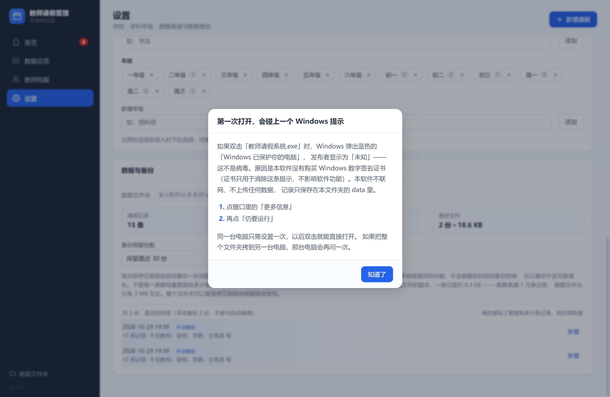

# 使用说明

> 面向使用者（教务处、年级组长）的完整操作手册。
> 开发与打包请看 [开发说明.md](../开发说明.md)，项目概览见 [README](../README.md)。
>
> 本文截图使用一套虚构的演示数据（示例学校、示例教师），与真实记录无关。

---

## 1. 这是什么

一个只在你自己电脑上运行的教师请假登记工具。**不联网、不登录、不上传任何数据**，
所有记录都保存在程序所在文件夹的 `data` 里，拷贝整个文件夹就能带走全部数据。

主要用途：

1. 登记教师请假（事假、病假、公假等），可区分学校、学科、年级
2. 一屏查看全部记录，可筛选、可导出 Excel
3. 按教师查看个人档案：累计请假次数与天数、类型分布、历年明细
4. 首页自动列出「还没销假」的记录，按紧急程度分红 / 黄 / 蓝三档

---

## 2. 打开与首次运行

双击文件夹里的 **`教师请假系统.exe`**。第一次打开需要几秒钟，属正常现象。

如果 Windows 弹出蓝色的「Windows 已保护你的电脑」，**不是病毒**——
原因是本软件没有购买 Windows 数字签名证书（证书只用于消除这条提示，不影响功能）。
点「更多信息」→「仍要运行」即可，同一台电脑只需设置一次。

程序在首次启动时也会弹一次说明，关掉后不再出现：



---

## 3. 界面一览

左侧是四个页面，右上角始终有「新增请假」按钮：

| 页面 | 用途 |
|---|---|
| **首页** | 三档到期提醒 + 今日在假名单 + 三个统计数字 |
| **数据总览** | 全部记录的一张大表，筛选 / 排序 / 分页 / 导出 |
| **教师档案** | 按「姓名 + 学校」聚合的教师卡片，点进去看个人档案 |
| **设置** | 提醒阈值、学校、请假类型、学科年级、数据与备份 |

---

## 4. 新增请假怎么填

点右上角「新增请假」，按下表顺序填：


| 字段 | 说明 |
|---|---|
| **学校** | 下拉选，选项在「设置 → 学校」维护。先选学校，姓名的下拉候选只列这所学校的老师 |
| **教师姓名** | 直接输入，本校输过的姓名会自动补全 |
| **学科 / 年级** | 下拉选，年级不确定可以选「不指定」 |
| **联系电话** | 选填 |
| **请假类型** | 事假、病假、公假等，可在设置里增删 |
| **开始日期 / 时段** | 必填，时段选上午或下午 |
| **结束日期 / 时段** | 见下方两种情形 |
| **请假天数** | **自动算**，不用手填，右侧会写明计算依据 |

### 4.1 结束日期的两种情况

**① 知道哪天回来**（大多数情况）
直接选结束日期和结束时段，系统按自然日自动计算天数。

**② 不知道哪天回来**（住院、突发急事）
勾选 **「结束日期未定」**。此时结束日期变灰不用填，天数从开始那天起
按「今天」实时累计，每天打开都会自动变大。等教师返校后点「销假」，
系统按销假当天结算并固定下来。

> 实际返校日期如果和销假那天不一致，先点「编辑」把结束日期改准，再销假。

### 4.2 表单会记住上次的选择

新建表单默认带出你**上一次录入时用的学校 / 学科 / 年级 / 类型**，
连着录同一所学校的人时不用每次重选。

但如果你输入的是**已有教师**的姓名，系统会优先带出这位老师自己的
学科、年级、电话；而且**只填你还没手动改过的字段**——
先选了学科再输姓名，不会被冲掉。

### 4.3 时段冲突不允许保存

同一位教师（**姓名 + 学校都相同**）的请假时段不能交叉。撞上了点保存不会成功，
弹窗顶部会列出撞上的是哪几条记录（区间、类型、天数、流水号）。

需要分段登记时请利用**半天**：同一天「上午」和「下午」不算重叠，可以分别记成两条
（例如上午事假、下午病假）。

如果撞上的是一条「结束日期未定、还没销假」的记录，提示里会单独说明——
这条会一直占着时间，先给它销假（或补上实际结束日期）再录新的。

### 4.4 同一个人名下的三种情形

| 情形 | 系统表现 |
|---|---|
| 同一位老师的新一次请假 | 姓名下方显示「本校已有 N 条记录 · 最近 X 月 X 日 病假」，保存时再确认一次，点「继续保存」 |
| 同名的另一位老师（不同学校） | 当作两个人，互不影响也不报冲突；姓名下方提示「在某校有记录，当前学校还没有」，提醒确认学校有没有选错 |
| 补录以前的请假 / 录入时就已销假 | 勾选表单下方的「已销假」，直接记为已销假，不进首页提醒 |

> 「结束日期未定」和「已销假」不能同时勾选——返校日期都不知道，就谈不上销假。

---

## 5. 首页


顶部三个数字：**本月请假人次 · 当前在假 · 未销假**。
左侧「首页」上的红色数字是「现在就该处理」的条数（只算红 / 黄两档）。

### 5.1 未销假提醒

按紧急程度分三组，颜色即优先级：

| 分组 | 颜色 | 含义 |
|---|---|---|
| 已结束 N 天 / 未定已请 N 天 | 红 | 已结束满 3 天，或未定已请满 14 天，**最该处理** |
| 今天刚结束，待确认销假 | 黄 | 今天到期的，或已结束满 1 天 / 未定满 7 天 |
| 还没结束，暂时不用销假 | 蓝 | 正在休、还没开始，只提示还剩几天，不抢注意力 |

天数阈值可在「设置 → 提醒阈值」里改。卡片上的具体操作：

- 点右下角 **「销假」** → 先弹确认框，写清哪位老师、哪一段、共几天，确认后才生效
  （避免名字相近时销错人）
- 点卡片**其他任何位置** → 打开这条记录查看 / 编辑
- 还没开始的记录**不显示销假按钮**，防止误点
- 右上角四个条件可叠加筛选：学校、类型、紧急程度、姓名
- 筛空了会提示「当前筛选下没有待销假记录」，并可一键清除筛选

### 5.2 今日在假


今天正在请假的教师名单，默认按学校分块，人多时也一眼看清。

- 右上角可切「按学校分组 / 按学科分组 / 不分组」，也能按学校和学科缩小范围
- 结束日期未定的记录显示「累计」字样，天数为当天实时值
- 点任意教师卡片可直接打开编辑窗口

### 5.3 请假区间的写法

起止的上午 / 下午都会标出来，鼠标停在上面可看带年份的完整日期：

```
10-19 上午 → 10-23 下午    跨天请假
10-25 下午 → 10-27 上午    首尾是半天，一眼看得出
10-26 全天                 同一天，整日（上午到下午）
10-26 上午 / 10-26 下午    同一天，只请半天
10-01 上午 → 未定          结束日期未定
```

---

## 6. 数据总览


- **筛选**：学校、姓名、学科、类型、状态、开始日期区间、是否代课，可叠加
- **排序**：点表头「教师姓名 / 学校 / 请假区间 / 天数 / 状态」
- **分页**：右下角翻页，每页 10 / 20 / 50 / 100 条可选
- **天数后的「累计」小标签**：结束日期未定的记录，数字为当天累计值
- **点教师姓名**：直接跳到该教师的档案页
- **每行右侧**：销假 / 编辑 / 删除
  删除会把这 1 条记录彻底移除，弹窗里写清是谁、哪一段、共几天；
  删除前程序会自动备份一份，删错可到设置里恢复
- **导出 Excel**：只导出当前筛选出来的记录

---

## 7. 教师档案


同一位教师以「**姓名 + 学校**」识别——改了校名会被当作另一位教师。

一屏一位教师一张卡片，显示累计天数、请假次数、最近一次、当前状态
（正在请假 / 待销假 / 已销假）。顶部筛选可叠加：学校、学科、统计范围
（全部时间 / 本学期 / 本学年 / 本月 / 自定义区间）、当前状态、姓名、排序。

### 7.1 教师详情


点卡片进入，包含：

- **四个数字**：累计次数、累计天数、平均每次、最近一次
- **请假类型分布**：按天数的彩色条 + 图例
- **按年份统计**：每年请了几次、几天
- **请假明细**：全部记录，可逐条销假 / 撤销销假 / 编辑 / 删除

明细表支持筛选（年份、类型、状态）和翻页，**筛选会同时改变上面的统计**：
标签会变成「筛选内请假 / 筛选内天数」，统计区上方也会提示；
点「改为按全部记录统计」即可恢复。

> 右上角的「正在请假 / 待销假」标签始终看全部记录，不受筛选影响
> ——否则选了旧年份，还在请假的老师会显示成已销假。

右上角三个按钮：

| 按钮 | 作用 |
|---|---|
| ← 返回教师列表 | 回到卡片列表 |
| ＋ 为这位教师新增请假 | 学校、姓名、学科、年级、电话都已填好，只选类型和日期，不会记到别人名下 |
| 删除这位教师 | 列出将要删掉的每一条记录，确认后一并删除；删前自动备份 |

---

## 8. 设置


- **提醒阈值**：固定结束日期、结束日期未定各有一套黄 / 红阈值
- **学校**：可增删。标签后的数字是有几条记录在用，**正在使用的学校不能删**，
  需先把记录改到别的学校。记录用到但列表里没有的学校会显示成虚线标签，
  点后面的「+」可一键补入
- **请假类型 / 学科与年级**：录入时的下拉选项，可随时增删；
  删除不影响已有记录里的原类型名称

### 8.1 数据与备份


显示记录条数、数据文件大小、备份占用；可调备份保留份数、立即备份、
打开文件夹、从备份恢复。

备份列表里每一份都标着 **手动备份 / 自动备份 / 恢复前自动备份**，
并写明里面有多少条记录、哪些教师——恢复前照着条数核对就不会挑错。

> **恢复出来不像删除前的数据？** 多半挑到了「自动备份」。
> 自动备份是每次保存**之前**的快照，所以最新一条常常正好是「刚删完」的状态。
> 看每行后面写的条数：删除前 5 条、删除后剩 2 条，就选写着「5 条记录」的那份，
> 或直接选标着「手动备份」的。恢复错了也不要紧——恢复前会自动存一份
> 「恢复前自动备份」，对它再恢复一次就回去了。

---

## 9. 导出的 Excel 有什么

**数据总览 → 导出 Excel**（全部或当前筛选的记录），两个工作表：

| 工作表 | 内容 |
|---|---|
| 请假明细 | 一行一条，含学校、学科、年级、起止日期、天数、状态、销假时间。日期是真正的日期格式，可在 Excel 里排序筛选；天数是数值，可求和 |
| 汇总统计 | 按学校、按教师、按请假类型、按学科四种汇总，各含人次与合计天数 |

**教师档案 → 导出 Excel**（这一位教师当前筛选的记录），第二个表换成「教师汇总」：

| 区块 | 内容 |
|---|---|
| 教师信息 | 姓名、学校、学科、年级、电话、当前状态 |
| 累计统计 | 累计次数、累计天数、平均每次、最近一次，以及总条数与其中已撤销条数 |
| 分布 | 按请假类型、按年份的次数 / 天数 / 占比 |

文件名自动带上教师姓名，如 `张三_请假明细_20261028.xlsx`。
导出文件第一行写明导出时间和当时的筛选条件，方便存档时说明这份表怎么筛出来的。

---

## 10. 数据存在哪里

就在程序所在文件夹的 `data` 子文件夹里：

```
教师请假系统/
├── 教师请假系统.exe
├── resources/app.asar
├── 使用说明.txt
└── data/                  ← 全部数据只在这里
    ├── leaves.json        全部请假记录（纯文本，可用记事本查看）
    ├── settings.json      阈值、学校、学科、年级、类型、流水号计数
    └── backups/           备份（自动 + 手动）
```

每次保存记录前，程序会**自动先备份一份**；超过「保留份数」（默认 30，可改 10~100）
后自动删掉最早的**自动**备份。手动备份单独按同样份数保留，不会被自动备份挤掉。

容量不会失控：一条记录约 0.3 KB，一学期 500 条约 150 KB，
录满 1 万条也只有 3 MB 左右；备份是数据文件的完整副本，最多 30 份。

---

## 11. 换电脑 / 备份

把**整个「教师请假系统」文件夹**（连同 exe 和 data）复制到 U 盘或另一台电脑，
双击 exe 就能继续用，数据完整保留。建议每周复制一份到 U 盘或网盘。

- 文件夹可以放在桌面、D 盘、U 盘、中文路径下，都能正常运行
- U 盘使用中不要直接拔出，先关闭程序
- 两台电脑各存各的数据，**不会自动同步**；要合并请只在一台电脑上录

---

## 12. 快捷键

| 快捷键 | 作用 |
|---|---|
| `Ctrl + N` | 新增请假 |
| `Ctrl + S` / `Ctrl + Enter` | 保存当前表单 |
| `Esc` | 关闭当前弹窗（有未保存内容会先确认） |
| `Ctrl + 加号 / 减号` | 缩放界面 |

关闭新增 / 编辑窗口时，如果填了内容还没保存，会先问一句「还没保存，确定关闭？」
——点遮罩、按 Esc、点右上角 × 都一样，手滑不会把填了一半的记录弄丢。
编辑窗口左下角还有「删除这条记录」，不必先关窗再回列表里找。

---

## 13. 常见问题

**Q：请假天数怎么算？**
按自然日计算，含周末。上午起算、下午结束各算半天。
例：10 月 20 日上午 → 10 月 22 日下午 = 3 天；同一天「上午 → 上午」或「下午 → 下午」= 0.5 天。

**Q：结束日期未定的请假，天数会不会算错？**
不会。它每天按「开始日 → 今天」重算，数字一天天变大，直到销假为止。
销假时按销假当天结算并固定。

**Q：为什么首页一直提醒某人？**
说明还没销假。点「销假」即可消除。点错了可在数据总览里「撤销销假」改回来；
结束日期未定的记录，撤销销假后会恢复成未定状态。

**Q：下拉里没有我要的学校 / 学科 / 年级？**
到「设置」里对应位置添加，加完立刻生效。学校下拉整个为空时保存按钮是灰的，
按提示去「设置 → 学校」加一所即可。学校是必填项，选不中时点保存会标红提示。

**Q：设置里某个学校的 × 是灰的，点不动？**
说明还有记录在用这所学校，标签后的数字就是条数。把这些记录的学校改到别处
（数据总览里逐条编辑），数字变成 0 后就能删。

**Q：同一个人能录两次重叠的请假吗？**
不能。同一位教师（姓名 + 学校相同）的时段不允许重叠，保存会失败并列出撞上的记录。
需要分段就改成不重叠的两段（同一天上午 / 下午的半天分段可以）。

**Q：系统提示「该教师已有记录」，是不是不能录了？**
可以录。这个提示只是帮你确认没有把姓名打错、也不是重复登记，
确实是新一次请假就点「继续保存」。

**Q：数据会不会丢？**
每次保存都会先在 `data/backups` 里留一份。万一文件损坏，程序启动时会提示，
可直接从备份恢复。

---

## 版本更新记录

历次版本变更（v1.7 → v2.1.1 的完整说明）见程序目录里的 `使用说明.txt` 末尾，
或 [开发说明.md](../开发说明.md) 的「版本记录」一节。
